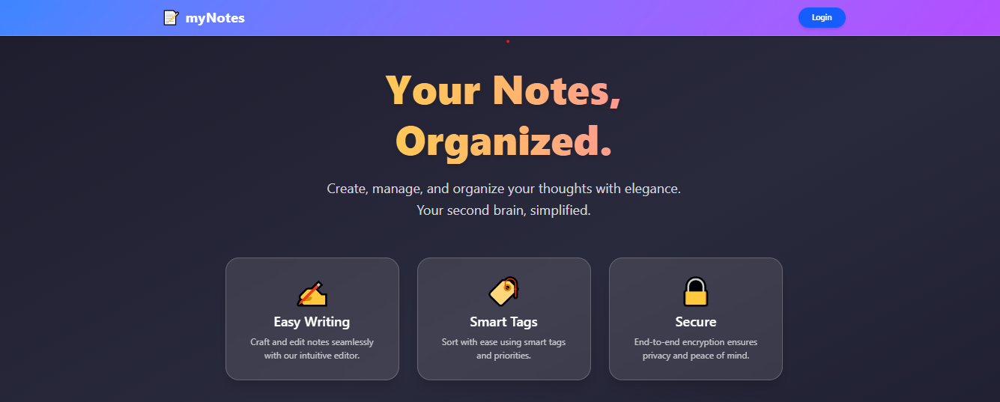
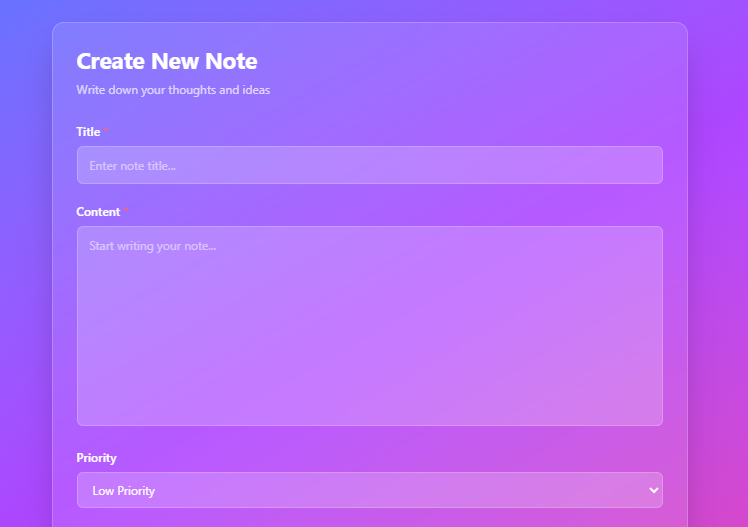
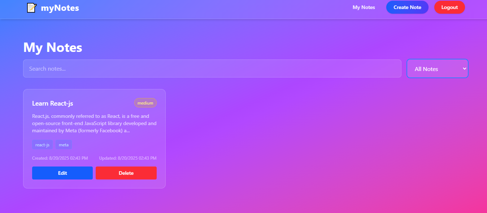
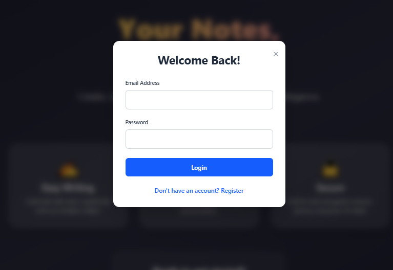

## 📝 myNotes - MERN Stack
A beautiful and modern notes application built with MERN Stack (MongoDB, Express.js, React.js, Node.js) featuring user authentication, CRUD operations, and a glassmorphism UI design.
## ✨ Features

### 🔐 Authentication

User Registration - Create new account with email validation
Secure Login - JWT token-based authentication
Session Management - Auto logout and protected routes
Cookie-based Auth - Secure HTTP-only cookies

### 📄 Notes Management

Create Notes - Rich text editor with title and content
Edit Notes - Update existing notes seamlessly
Delete Notes - Remove unwanted notes
View All Notes - Dashboard with all user notes

### 🎯 Advanced Features

Priority System - High, Medium, Low priority levels
Tags System - Add custom tags for better organization
Search & Filter - Find notes by content or priority
Real-time Timestamps - Creation and update time display
Responsive Design - Works perfectly on all devices

### 🎨 UI/UX

Glassmorphism Design - Modern glass effect UI
Gradient Backgrounds - Beautiful color schemes
Smooth Animations - Hover effects and transitions
Loading States - User-friendly loading indicators
Toast Notifications - Real-time feedback messages

### 🚀 Tech Stack

#### Backend

Node.js - Runtime environment
Express.js - Web framework
MongoDB - NoSQL database
Mongoose - ODM for MongoDB
JWT - Authentication tokens
bcrypt - Password hashing
cookie-parser - Cookie handling
cors - Cross-origin requests
dotenv - Environment variables

#### Frontend

React.js - UI library
Tailwind CSS - Utility-first CSS
React Router - Client-side routing
Axios - HTTP client
React Hot Toast - Notifications
Context API - State management

### 📁 Project Structure
```bash
notes-app/
├── backend/
│   ├── config/
│   │   └── db.js
│   ├── controllers/
│   │   ├── notes.controller.js
│   │   └── user.controller.js
│   ├── middleware/
│   │   └── isVerifyUser.js
│   ├── models/
│   │   ├── notes.model.js
│   │   └── user.model.js
│   ├── routes/
│   │   ├── note.routes.js
│   │   └── user.routes.js
│   ├── .env
│   ├── package.json
│   └── server.js
│
├── frontend/
│   ├── public/
│   ├── src/
│   │   ├── components/
│   │   │   ├── LoginModal.jsx
│   │   │   ├── Navbar.jsx
│   │   │   ├── NoteCard.jsx
│   │   │   └── Loading.jsx
│   │   ├── pages/
│   │   │   ├── CreateNote.jsx
│   │   │   ├── Dashboard.jsx
│   │   │   ├── EditNote.jsx
│   │   │   └── Home.jsx
│   │   ├── context/
│   │   │   └── AuthContext.jsx
│   │   ├── hooks/
│   │   │   └── useAuth.js
│   │   ├── utils/
│   │   │   ├── api.js
│   │   │   └── formatDate.js
│   │   ├── App.jsx
│   │   ├── index.js
│   │   └── index.css
│   ├── package.json
│   └── tailwind.config.js
│
└── README.md
```
## ⚙️ Installation & Setup
### Prerequisites

Node.js (v14 or higher)
MongoDB (local or Atlas)
Git
## 📋 API Endpoints
###
```bash
POST /api/v1/user/register - Register new user
POST /api/v1/user/login    - Login user  
GET  /api/v1/user/logout   - Logout user
```
### Notes Routes 
```bash
POST   /api/v1/note/create     - Create new note
GET    /api/v1/get-note        - Get all user notes
PUT    /api/v1/note/update/:id - Update specific note
DELETE /api/v1/note/delete/:id - Delete specific note
```

### 🎯 Usage Guide
### 1. Home Page

- Beautiful landing page with app features
Click "Login" button to access authentication

### 2. Authentication

- Register with fullname, email, and password
Login with email and password
- Automatic redirect to create note page after login

### 3. Create Note

- Add title and content (required)
- Set priority level (High/Medium/Low)
- Add custom tags for organization
- Real-time validation and feedback

### 4. Dashboard

- View all your notes in a clean grid layout
- Search notes by title or content
- Filter by priority level
- Edit or delete individual notes

### 5. Edit Note

- Update any note field
- Add or remove tags
- Change priority level
- Auto-save functionality

## 🔒 Security Features

- Password Hashing - bcrypt with salt rounds
- JWT Authentication - Secure token-based auth
- HTTP-Only Cookies - XSS protection
- CORS Protection - Configured origins
- Input Validation - Server-side validation
- Protected Routes - Authentication middleware

## 🌟 Future Enhancements

- Rich text editor with formatting
- File attachments support
- Note sharing functionality
- Categories and folders
- Dark/Light theme toggle
- Export notes (PDF, Word)
- Real-time collaboration
- Mobile app version
- Offline support
- Advanced search with filters

### 🤝 Contributing

- Fork the repository
- Create feature branch (git checkout -b feature/AmazingFeature)
- Commit changes (git commit -m 'Add AmazingFeature')
- Push to branch (git push origin feature/AmazingFeature)
- Open Pull Request
## 📸 Screenshots
Home Page



Edit Note



Dashboard



Create Note


Login Modal


